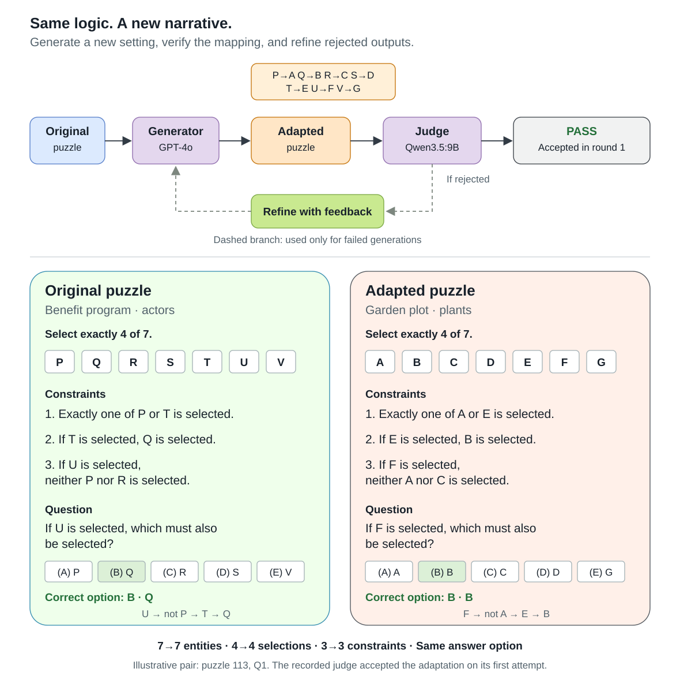

# Reasoning Recontextualisation

Tools for transforming logic puzzles into new narrative settings while preserving their constraints, questions, and answer correspondence. Use the pipelines to compare language models as puzzle solvers, generators, and judges.

The workflow supports API models from OpenAI, Anthropic, and Google, plus local models served through Ollama. Generator and judge settings are configured independently. Each run records intermediate outputs, feedback, and final decisions for later analysis.

## Workflow



The example preserves a one-to-one entity mapping, all three constraints, and the correct answer's option position. It passed verification on the first attempt; the dashed feedback branch shows how rejected generations are refined. The figure uses shortened wording for readability.

1. Prepare structured multiple-choice question units.
2. Evaluate solvers on the original questions.
3. Generate adaptations with explicit entity mappings.
4. Judge structural and logical preservation, then refine rejected adaptations.
5. Evaluate solvers on matched original and adapted questions.
6. Audit output parsing and analyze results.

A judge's acceptance is a model-based assessment of equivalence. It does not constitute a formal proof.

## Install

Use Python 3.10+ and run commands from this repository's root:

```sh
python -m venv .venv
# Activate .venv using your shell's standard activation command.
python -m pip install -e ".[api,analysis]"
python -m recon --help
```

For Ollama-only runs, install the core package with `python -m pip install -e .`. Start Ollama separately and download the models you plan to use:

```sh
ollama serve
# In another terminal:
ollama pull qwen3.5:9b
ollama pull llama3.1:8b
```

Model tags in the configuration files are editable presets. Check that the selected model is installed or available from its provider. Different model versions, quantization settings, and serving engines can change results.

Set `OPENAI_API_KEY`, `ANTHROPIC_API_KEY`, or `GEMINI_API_KEY` in your process environment for the provider you select. `.env.example` lists the variable names. `.env` is not loaded automatically.

## Input format

Supply your own CSV or XLSX files with one row per question. Datasets and generated puzzle collections are not bundled with this repository.

| Column | Meaning |
|---|---|
| `Puzzle_Number` | Source puzzle identifier |
| `Question_Number` | Question identifier, consistent across stages |
| `Sample` | Full `<context>`, `<clues>`, and `<question>` unit, including A-E choices |
| `Answer` | Gold letter A-E, needed for scoring and paired-set construction |
| `Solved_Percentile` | Difficulty metadata on a 0-100 scale, needed for stratified sampling |

Keys must be unique within a run. Paired sets also carry `adaptation_id` to distinguish adaptations of the same source question by different generators. Only the puzzle text in `Sample` is sent to the solver or generator; gold labels remain available for evaluation.

To convert a wide-format workbook containing `Puzzle_Number`, `Context`, `Clues`, `Q1`, `Q2`, and subsequent question columns:

```sh
python -m recon prepare --input private/puzzles.xlsx --output data/questions.csv
```

Attach gold labels by puzzle/question keys after preparation. The converter does not assume an answer-column layout or perform OCR.

## Try a complete example

This original example can be shared. It contains no benchmark question or model-generated dataset. Run commands from the repository root.

```sh
python examples/create_sample.py --output data/synthetic_puzzle.csv
```

Create the file once; if it already exists, use it or choose a new output filename. The script uses a CSV writer to quote the multiline `Sample` correctly. To create an Excel equivalent, use `--output data/synthetic_puzzle.xlsx`.

### One complete input row

| Column | Value |
|---|---|
| `Puzzle_Number` | `SYN001` |
| `Question_Number` | `Q1` |
| `Sample` | The complete block below, in a single cell |
| `Answer` | `D` |
| `Solved_Percentile` | `50`, illustrative metadata only; not a measured human score |

```xml
<context>
Three delivery vans, Amber, Birch, and Cedar, occupy positions 1, 2, and 3 in a queue.
Each van occupies exactly one position, and no position contains more than one van.
</context>
<clues>
1. Amber is somewhere before Birch.
2. Cedar is immediately after Amber.
</clues>
<question>
Which of the following must be the order of the vans, from position 1 to position 3?
(A) Amber, Birch, Cedar
(B) Birch, Amber, Cedar
(C) Cedar, Amber, Birch
(D) Amber, Cedar, Birch
(E) Birch, Cedar, Amber
</question>
```

The unique valid order is Amber, Cedar, Birch. The gold answer is D. Gold labels and percentile metadata are stored outside `Sample` and are not passed to models.

### Run the example with a live model

These commands require Ollama to be running with `qwen3.5:9b` downloaded:

```sh
python -m recon solve --config configs/ollama/qwen.json --input data/synthetic_puzzle.csv --mode zs --output outputs/sample_solve.jsonl
python -m recon summarize --input outputs/sample_solve.jsonl --output outputs/sample_solve_summary.json
python -m recon adapt --config configs/ollama/qwen.json --input data/synthetic_puzzle.csv --output outputs/sample_adapt.jsonl
python -m recon export --input outputs/sample_adapt.jsonl --output outputs/sample_adapt.csv
```

A successful solver should output D. Adaptation acceptance depends on what the live generator and judge produce. To use a cloud generator, replace the config with an API preset and set that provider's API key. The configured judge still requires Ollama.

### Run the offline check

Run the offline end-to-end check without a model server or API credentials:

```sh
python -m unittest discover -s tests -p test_sample_workflow.py -v
```

That test invokes the real CLI, data loader, official prompts, Ollama request builder, parsers, checkpointing, feedback refinement, paired-set construction, both solver modes, scoring, and CSV export. HTTP responses are simulated. It verifies plumbing and deterministic behavior, not model accuracy or a real judge's equivalence assessment.

The offline sample check passes. Live inference was not validated in the development session because no API keys were configured and the local Ollama endpoint was unavailable.

Output files stay in ignored local folders. Use fresh output names for a new run, or `--resume` with unchanged inputs/configuration.

## API models

API generators use provider-specific SDKs. The supplied adaptation presets use a local Qwen judge, which requires a running Ollama server even when the generator is an API model.

```sh
python -m recon solve --config configs/api/openai_gpt4o.json --input data/questions.csv --mode zs --output outputs/gpt4o_original_zs.jsonl
python -m recon adapt --config configs/api/openai_o3.json --input data/questions.csv --output outputs/o3_adaptations.jsonl
python -m recon adapt --config configs/api/claude_haiku.json --input data/questions.csv --output outputs/claude_adaptations.jsonl
python -m recon adapt --config configs/api/gemini_25_flash.json --input data/questions.csv --output outputs/gemini_adaptations.jsonl
```

Use `--mode cot` for explicit stepwise solver prompting. The o3 preset uses native reasoning with medium effort. Additional configuration files include Gemini 3 Flash Preview generation. Provider availability and supported reasoning controls vary by model.

## Local models with Ollama

Use any chat-capable model tag available on your Ollama server. Model selection is independent for solving, adaptation generation, and judging. The Qwen, Llama, and DeepSeek configuration files remain sample presets; none is a required model.

### Choose models directly

No configuration file is needed. Replace the quoted model tags below with exact tags from `ollama list`:

```sh
python -m recon solve --model "YOUR_SOLVER:TAG" --input data/synthetic_puzzle.csv --mode zs --output outputs/custom_solve.jsonl
python -m recon adapt --generator-model "YOUR_GENERATOR:TAG" --judge-model "YOUR_JUDGE:TAG" --input data/synthetic_puzzle.csv --output outputs/custom_adapt.jsonl
```

Use the same tag in both adaptation roles for a self-judge experiment, or different tags for an independent judge. Config-free adaptation requires an explicit judge model. The six canonical prompts stay unchanged across models.

### Servers and generation controls

Both roles default to `http://localhost:11434`. Override their server roots independently:

```sh
python -m recon adapt --generator-model "YOUR_GENERATOR:TAG" --base-url http://localhost:11434 --judge-model "YOUR_JUDGE:TAG" --judge-base-url http://localhost:11435 --max-tokens 4000 --judge-max-tokens 8192 --num-ctx 16384 --judge-num-ctx 16384 --input data/synthetic_puzzle.csv --output outputs/custom_servers.jsonl
```

Primary-role options are `--think`, `--max-tokens`, `--num-ctx`, `--temperature`, and `--timeout`. Adaptation also accepts their independent `--judge-...` equivalents. The same `--model` and primary controls are available for `audit-answer` and `audit-judge`.

Thinking is omitted by default for direct model selection, allowing the model's own behavior. Use `--think auto` to clear a preset's thinking setting, `--think true` or `--think false` for compatible models, or the exact named level supported by that model. Use `--judge-think` separately for the judge. Do not assume every model supports the same thinking controls. See [Ollama's thinking documentation](https://docs.ollama.com/capabilities/thinking) for discovering supported values with `/api/show`.

### Keep reusable configurations

Copy [configs/ollama/custom.example.json](configs/ollama/custom.example.json), replace its model tags, and pass it with `--config`. The optional `solver` role selects a solver independently of the adaptation `generator`; existing presets reuse `generator` for solving. Each role can set its own `base_url`, `max_tokens`, `num_ctx`, `temperature`, `think`, and `timeout`. For additional native generation settings, supply an `options` object such as `{"seed": 42, "top_p": 0.9}`. An optional `keep_alive` setting is also forwarded to Ollama. Top-level token/context/temperature controls take precedence over their corresponding `options` entries.

Existing example presets work as before:

```sh
python -m recon adapt --config configs/ollama/qwen.json --input data/questions.csv --output outputs/qwen_adaptations.jsonl
python -m recon adapt --config configs/ollama/llama.json --input data/questions.csv --output outputs/llama_adaptations.jsonl
python -m recon solve --config configs/ollama/llama.json --input data/questions.csv --mode cot --output outputs/llama_original_cot.jsonl
```

You can override a preset's judge while retaining its generator:

```sh
python -m recon adapt --config configs/api/openai_o3.json --judge-model "YOUR_JUDGE:TAG" --input data/questions.csv --output outputs/o3_custom_judge.jsonl
```

Selecting a new model with `--model`, `--generator-model`, or `--judge-model` replaces that role's preset, avoiding inherited thinking controls from another model. Apply any desired role settings explicitly afterward. Overrides are recorded in the run manifest, so resume refuses a changed model or effective configuration.

The selected model must support text chat, fit in the available hardware, and produce the required answer or judge format. Model-independent transport does not guarantee reasoning accuracy or reliable judging for every model. The DeepSeek Ollama sample uses a different execution stack from the archived Hugging Face / BitsAndBytes runs.

## Sampling and paired evaluation

Optional stratified sampling uses `Solved_Percentile`: Hard below 30, Medium from 30 to below 60, and Easy from 60 to 100. Specify counts and a random seed for your experiment:

```sh
python -m recon sample --input data/questions.csv --counts Hard:50,Medium:50,Easy:50 --seed 42 --output data/generation_sample.csv
```

Pool adaptation exports locally, preserving generator identity and source IDs. Select successful adaptations, then split them into matching original and adapted inputs:

```sh
python -m recon select-pairs --input private/pooled_adaptations.csv --originals data/questions.csv --counts Hard:34,Medium:34,Easy:32 --seed 42 --output data/paired_questions.csv
python -m recon split-pairs --input data/paired_questions.csv --output data/paired_questions
python -m recon solve --config configs/api/openai_gpt4o.json --input data/paired_questions.original.csv --mode cot --output outputs/gpt4o_pairs_original.jsonl
python -m recon solve --config configs/api/openai_gpt4o.json --input data/paired_questions.adapted.csv --mode cot --output outputs/gpt4o_pairs_adapted.jsonl
```

The counts above are examples. Selection samples adaptation rows without replacement and does not balance generators or enforce one adaptation per source puzzle. Join paired results using `adaptation_id` and source IDs. Account for repeated source puzzles when performing statistical comparisons.

## Checkpoints and results

Each completed row is atomically checkpointed to JSONL. Adaptation records retain generation rounds, raw responses, available reasoning, entity mappings, judge parsing attempts, feedback, and final outcomes. A run manifest records input content hashes, effective configuration, prompt hashes, stage, and solver mode.

Repeat a command with `--resume` to skip checkpointed rows. Resume requires identical inputs, configuration, prompts, and stage. Failed rows remain checkpointed; retry them in a separate run. Use `--limit 2` for a small live check. Runs containing infrastructure or judge failures exit with status 2 after saving results.

Export results, inspect judge execution, audit answer extraction, or summarize accuracy:

```sh
python -m recon export --input outputs/o3_adaptations.jsonl --output outputs/o3_adaptations.csv
python -m recon audit-judge --config configs/api/gemini_audit.json --input outputs/o3_adaptations.jsonl --output outputs/o3_judge_audit.jsonl
python -m recon audit-answer --config configs/api/gemini_audit.json --input outputs/gpt4o_original_zs.jsonl --output outputs/gpt4o_answer_audit.jsonl
python -m recon summarize --input outputs/gpt4o_original_zs.jsonl --output outputs/gpt4o_summary.json
```

Audits append separate fields and preserve primary decisions. Missing predictions count as incorrect when scoring. Judge audits inspect prior verdicts and execution traces; they do not independently establish puzzle equivalence.

## Repository layout

- `recon/`: data preparation, provider transports, parsers, experiment stages, and CLI.
- `configs/api/` and `configs/ollama/`: editable model and runtime presets.
- `prompts/`: six canonical solver, generator, judge, and audit prompts. All providers share the same solver prompts; see [the prompt guide](prompts/README.md).
- `analysis/notebooks/`: archived analysis notebooks with saved outputs cleared and credentials redacted.
- `docs/notebook_inventory.json` and `docs/code_review.json`: source notebook inventory, duplicate relationships, and configuration records.
- `docs/REPRODUCIBILITY.md`: implementation provenance, configuration differences, and reproduction limits.
- `docs/VALIDATION.md`: checks performed and remaining runtime limitations.
- `scripts/check_publication.py`: checks for credentials, dataset artifacts, and saved notebook outputs.

See [the analysis guide](analysis/README.md) before using the archived notebooks. They retain their original file-path and column assumptions and may need local configuration.

## Validation and data handling

```sh
python -m unittest discover -s tests -v
python scripts/check_publication.py
```

The offline tests use artificial inputs. Live SDK integrations and model availability require checks in your own environment. API stages send the selected puzzle content to the configured provider and can incur charges.

Keep source data, generated adaptations, traces, result files, and credentials in ignored local folders. The publication checker is a useful check, but review files and Git history before sharing a repository. Select a code license before distributing the project.
